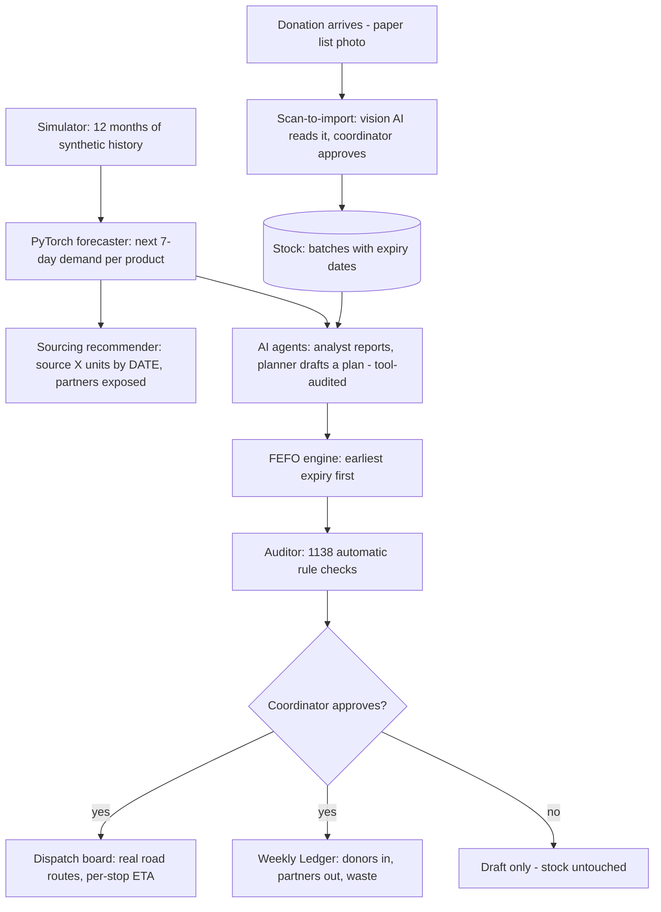

# NourishLink AI

**The decision layer for community food banks.** A Django platform that turns
donated perishable stock into audited, forecast-informed distribution plans —
using a rule-based FEFO engine, a PyTorch demand forecaster, and LLM-backed AI
agents that can only *propose*; a human coordinator always approves.

> Food banks are good at **moving** food. Their unsolved problem is **deciding**
> — what to give, when, to whom, without wasting perishables. NourishLink AI
> models the four failures every food bank reports (demand surprise, expiry
> waste, manual matching, no records) and fixes each one — then **measures**
> the result instead of just claiming "we added AI".

Final-year AIML project · Bengaluru community food bank scenario · all data synthetic

---

## How one week flows through the system



**One principle everywhere: AI drafts, humans approve, everything is audited.**

---

## The three configurations evaluated (the experiment)

The same synthetic scenario is replayed under three policies — this is the
project's academic core:

| Config | Policy | Where it lives |
|--------|--------|----------------|
| **A** | Rule-based FEFO only — earliest-distribution-cutoff batches first, requests ordered by required-by date | `core/allocation.py` |
| **B** | FEFO + forecast-informed ordering — requests for products whose 7-day forecast exceeds free stock are prioritised by worst gap | `core/allocation.py` (`forecast_boost=True`) |
| **C** | FEFO + AI agents — an Inventory Analyst (reads stock/forecasts/requests) and a Distribution Planner (drafts a plan through audited tool calls) | `core/agent_tools.py`, `core/agents.py` |

**Measured results** (reproduce with `python manage.py evaluate`):

| Metric | Result |
|--------|--------|
| Fulfilment (A / B / C) | **1,171 / 1,552 units = 75.4%** each, with 381 units unmet and 263 at-risk units tracked |
| Forecast MAE | **7.66** (NN) vs 7.96 (28-day rolling baseline) |
| Forecast WAPE | **0.118** vs 0.122 |
| Product wins (NN vs baseline) | **7 / 12** — reported honestly, including where the baseline wins |
| Allocation audit | **1,138 rule checks, 0 violations** |
| Agent run (live LLM) | 7 audited tool calls, ~106 s, drafts only |

The LLM is **optional**: without any API key the agents produce equivalent
drafts deterministically (`FALLBACK` in run records) — the system never stops.

---

## Feature tour

- **Dashboard** — mission hero, four animated impact counters (units
  distributed, batches rescued, partners served, rescue %), demand-outlook
  chart for the riskiest products and a "Sourcing needed" panel.
- **Scan-to-import** (`/inventory/scan/`) — photograph a paper donation list;
  a vision LLM reads the product lines as a **draft**; the coordinator fixes
  quantities in an editable table and approves → products and batches enter
  stock, photo kept as audit source. LLM down → clean manual-entry fallback.
- **Sourcing recommendations** (`/sourcing/`) — the visible "you will run out"
  loop: units to source, cover-by date, exposed partners, a plain-English
  coordinator brief (optional **Explain with AI** rewrite) and one-click
  next steps (pre-filled donation form / generate FEFO plan).
- **Allocation plans** — AI-drafted or rule-generated FEFO plans with
  validate-on-approve (rechecks stock, cutoffs, requests inside a
  transaction), human approval reserving stock, and pickup completion
  reducing it.
- **Dispatch board** (plan → "Open dispatch board") — fulfilment
  control-plane view: Leaflet map with real driving roads and per-stop ETAs
  (public OSRM router), resilient keyless tile chain (Esri → OpenStreetMap →
  offline SVG schematic, with a retry button), branded warehouse/shelter pins,
  per-truck manifests with stop status chips (planned/scheduled/delivered),
  KPI chips and the plan's execution timeline. Routes are a **stored record**
  computed once per truck count. Read-only.
- **Weekly Ledger** (`/reports/ledger/`) — government-style accountability
  for any week: donations received per donor, stock distributed per partner
  organisation (with charts), net-flow footer (received in / distributed out /
  expired unrescued). Print/PDF and CSV export.
- **Evaluation** (`/reports/evaluation/`, direct URL — not in the menu) — the
  one-page A/B/C + forecast-quality summary with "Save as PDF": the thesis
  artifact.
- **Design system** — Bangalore Food Bank inspired: orange `#eb5310` action
  palette + deep navy `#082454`, pill buttons, vendored Mulish/Quicksand
  variable fonts and public-domain photographs (no CDNs at runtime).

---

## Quick start

```bash
python -m venv .venv
.venv\Scripts\activate                # Windows
pip install django torch numpy scikit-learn matplotlib

python manage.py migrate
python manage.py seed_data            # orgs, users, donors, products
python manage.py simulate --seed 42   # 12-month history + live pending pool
python manage.py forecast             # trains NN + baseline, stores forecasts
python manage.py createsuperuser      # optional (admin UI)

python manage.py runserver            # http://127.0.0.1:8000
```

Demo credentials (from `seed_data`): `admin / admin123`,
`coord1 / coord123`, `partner1..partner6 / partner123`.

**5-minute demo script:** dashboard → Inventory → *Scan a donation list*
(upload any list photo) → Sourcing (*Explain with AI*) → AI Proposals (*Run
AI proposal*) → open the draft plan → *Approve* → *Open dispatch board* →
Weekly Ledger → `/reports/evaluation/`.

## Key commands

| Command | Purpose |
|---------|---------|
| `python manage.py seed_data` | Seed base orgs/users/donors/products |
| `python manage.py simulate --seed 42` | Generate synthetic donation/request history + live pending pool |
| `python manage.py forecast` | Train PyTorch MLP forecaster (with synthetic-lag ablation) + rolling-28 baseline; writes `data/forecast/report.json` |
| `python manage.py agent_proposal` | Run the analyst+planner cycle from the CLI (draft plan only) |
| `python manage.py evaluate` | Run the A/B/C comparison over the current scenario; writes `data/evaluation/results.json` |
| `python manage.py paperfigures` | Export publication figures at 300 dpi (`data/paper/fig1_abc_comparison.png`, `fig2_forecast_quality.png`) |

## Optional: enabling the LLM (Config C "live" mode)

Agents work fully without any API key (deterministic fallback). To use real
models, create a free account at [openrouter.ai](https://openrouter.ai), then:

```powershell
setx OPENROUTER_API_KEY "sk-or-..."     # open a NEW terminal afterwards
# optional overrides:
#   setx OPENROUTER_MODEL "openrouter/free"            (text agents)
#   setx OPENROUTER_VISION_MODEL "..."                 (scan-to-import)
```

Approved usage: the LLM only *narrates and proposes*; all numeric facts come
from DB tools; all state changes stay behind the audited approval flow; any
outage degrades gracefully to the deterministic fallback.

## Test suite

```bash
python manage.py test core
```

**113 tests** cover the simulator, FEFO engine, approval workflow, forecast
orchestration, agent tool layer and security (scripted fake-LLM, no network),
forecast-boost ordering, dispatch route persistence + OSRM fallback, the
narrative sanitizer (reasoning-leak regression), scan-to-import, the weekly
ledger and permission boundaries.

## Ethical notes baked into the design

- **Determinism under stress** — LLM outage → fallback agents at full
  capacity; nothing locks stock during incidents.
- **Human in the loop** — agents only draft; approval, record-keeping and
  stock changes are coordinator actions.
- **Data realism** — all records synthetic; forecasts replayed against
  hold-out weeks (MAE/WAPE) with a documented ablation to avoid over-claiming.
- **Waste visibility** — at-risk units, rescue % and expired-unrescued are
  first-class numbers so the intervention stays measurable.
- **Distribution safety** — expired stock is structurally unallocatable; the
  auditor re-validates every plan before approval.

## Project layout

```
nourishlink/            Django settings
core/                   models, allocation (FEFO), forecast (MLP),
                        agents (tool-audited LLM loops), routing (OSRM),
                        sourcing (recommendations), evaluation, views
core/management/        seed_data, simulate, forecast, evaluate,
                        agent_proposal, paperfigures
templates/core/         server-rendered UI (no JS framework needed)
static/vendor/          Leaflet, Chart.js, fonts (offline-capable)
data/forecast/          hold-out report + stored forecasts
data/evaluation/        A/B/C results (results.json)
data/paper/             300-dpi thesis figures
data/uploads/           scan-to-import photos (git-ignored)
```

## Tech stack

Django 6 · PyTorch (MLP forecaster, ensemble) · pandas/numpy/scikit-learn ·
OpenRouter LLMs (free tier: text + vision) · Leaflet + OSRM + Esri/OSM tiles ·
Chart.js · SQLite.

## Future work

Multi-warehouse network mode · real transaction data via NGO partnerships ·
GPS fleet optimisation · motorised request intake (WhatsApp bot) · weights-based
(kg/litre) stock accounting instead of unit counts.

## Credits

Basemaps © Esri & © OpenStreetMap contributors · driving routes by the public
[OSRM demo server](https://router.project-osrm.org/) · LLMs via
[OpenRouter](https://openrouter.ai) · photographs from Wikimedia Commons
(public domain) · design language inspired by
[Bangalore Food Bank](https://bangalorefoodbank.com). Built as a final-year
AIML project; all names, organisations and data are synthetic.
